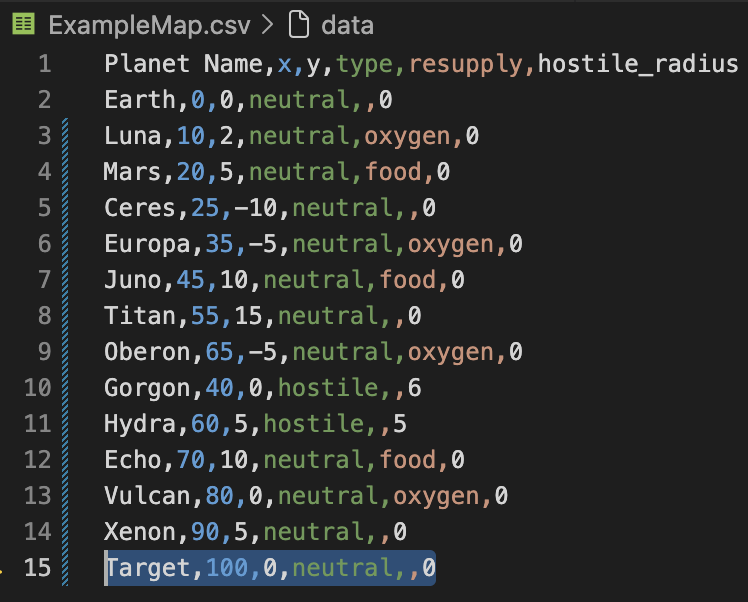
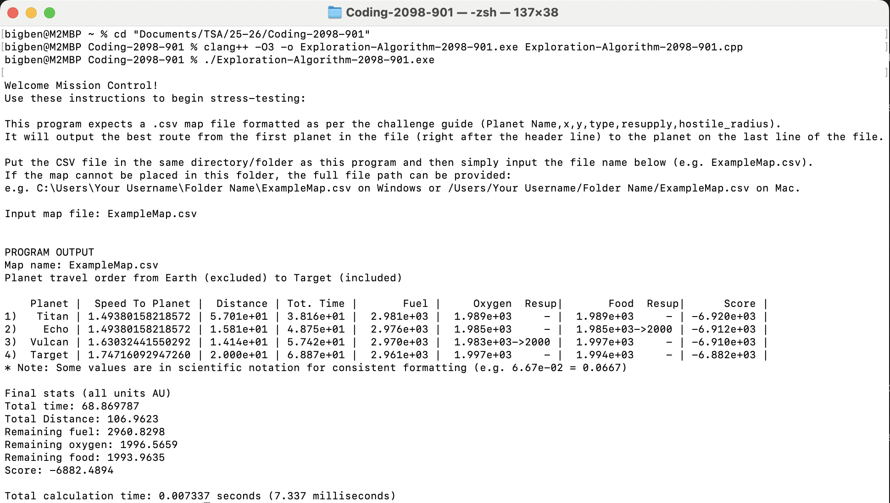
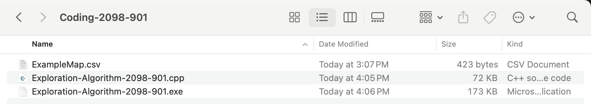

# TSA Region 8 HS Coding Challenge: Exploration Algorithm
- Team ID: 2098-901\
- Individual ID: 2098-010\
- Language: C++20 (chosen for performance)\
- Interface: Command-line interface (terminal)\
- Software: Visual Studio Code

# Resources:
The following classical algorithms were implemented in our program:
1. Bidirectional A* (for pathfinding)
2. Yen's algorithm (for pathfinding)
3. Bisection method (for root-finding)
4. Brent's method (for minimization)

As per the TSA event guide rules, only the language's standard library (std) was used (no 3rd-party libraries). Obviously no AI was used in the making of this project.\
Note: Since this program is kind of long, our team organized it into regions and added descriptive comments to improve readability.

# IMPORTANT - Compile/Run Instructions
It is assumed that you have a C++20-compatible compiler installed, preferably either g++ or clang++ (Mac comes with clang++ installed). If you do not have a compiler, you can google how to intall one. Then, use the following steps to compile and run the program on your operating system:

On Windows:
1. Open the run dialog box (Win + R)
2. Type cmd, press Enter
3. Enter the following line to navigate to the project folder:\
cd path\to\project
4. Enter the following line to compile:\
g++ -O3 -o Exploration-Algorithm-2098-901.exe Exploration-Algorithm-2098-901.cpp
5. Enter the following line to run:\
Exploration-Algorithm-2098-901.exe

On Mac:
1. Open Terminal
2. Enter the following line to navigate to the project folder:\
cd path/to/project
3. Enter the following line to compile:\
clang++ -O3 -o Exploration-Algorithm-2098-901.exe Exploration-Algorithm-2098-901.cpp
4. Enter the following line to run:\
./Exploration-Algorithm-2098-901.exe

On Linux:
1. Open Terminal
2. Enter the following line to navigate to the project folder:\
cd path/to/project
3. Enter the following line to build:\
g++ -O3 -o Exploration-Algorithm-2098-901.exe Exploration-Algorithm-2098-901.cpp
4. Enter the following line to run:\
./Exploration-Algorithm-2098-901.exe

## Input Instructions
This program expects a .csv map file formatted the same as the challenge guide provided by Region 8 (Planet Name,x,y,type,resupply,hostile_radius).\
Put the CSV file in the same directory/folder as this program (Coding-2098-901) and then simply input the file name (e.g., ExampleMap.csv).
If the map cannot be placed in this folder, the full file path can be provided:\
e.g., C:\\Users\\Your Username\\Folder Name\\ExampleMap.csv on Windows or /Users/Your Username/Folder Name/ExampleMap.csv on Mac.\

REQUIREMENTS FOR VALID MAP:
- The map must be a .csv file beginning with a header line formatted "Planet Name,x,y,type,resupply,hostile_radius".
- The planet on the first line after the header line is assumed to be the starting planet (e.g., Earth).
- The planet on the last line of the file is assumed to be the destination/target planet.

As per the challenge guide, after the header line, each entry of the file must consist of the following columns, separated by commas:
- Column 1: Planet Name. Must be alphanumeric with the only special characters being spaces, dashes, and parentheses.
- Column 2: X-Position. Must be numerical.
- Column 3: Y-Position. Must be numerical.
- Column 4: Type. Either neutral or hostile. The start and target planets must be neutral.
- Column 5: Resupply. Either oxygen, food, or none
- Column 6: Hostile Radius. Planets with type neutral must have a hostile radius of 0. Planets with type hostile must have a positive hostile radius. The start and target planets must have a hostile radius of 0, and also cannot be enclosed within the hostile radius of another planet.

Our program will parse the .csv file and notify you of any violations of the above formatting rules.

## Output Format
This program will output the name of the map used and the best planet travel order from the first planet in the file (right after the header line) to the planet on the last line of the file.\
The output is formatted in a table with the following columns:
- Column 1: The travel order and the name of the planet to travel to. The first row is the first planet excluding the start planet (Earth). The last row is the target planet.
- Column 2: The speed used between the planet in the previous row (Earth for the first row) to the planet in this row.
- Column 3: The distance between the planet in the previous row and the planet in this row.
- Column 4: The cumulative travel time so far. Computed as previous total travel time + distance / speed.
- Column 5: The fuel left upon arrival to the planet in this row.
- Column 6: The oxygen left upon arrival to the planet in this row.\
"Resup" indicates oxygen left after a resupply, with "-" indicating no oxygen resupply.
- Column 7: The food left upon arrival to the planet in this row.\
"Resup" indicates oxygen left after a resupply, with "-" indicating no oxygen resupply.
- Column 8: Score. Computed as Cumulative Travel Time - (Fuel Left + Oxygen Left + Food Left).

Finally, the following final stats are provided:
- Total travel time (equal to the cumulative travel time at the last row of the table).
- Total distance (equal to sum of all distances in table).
- Remaining fuel, oxygen, and food.
- Final score. Computed as Total Travel Time - (Fuel Left + Oxygen Left + Food Left).
- Total calculation time: The time the program took the calculate the solution (in seconds and milliseconds), from the user inputting the file name to the program returning its final route.

NOTE: All units (except total calculation time) are in arbitrary units (AU), defined by the challenge guide. Some values int he table are in scientific notation for consistent formatting, e.g., 6.67e-02 = 0.0667 and 6.67e+02 = 667.

# Example Screenshots
## Example Map Format:

## Full Compile and Run Example on Mac (Default Terminal):

## Example Folder Contents (After Compilation)
